<div align="center">

<a href="https://github.com/ardianryan/papermc-skill">
  
</a>

# ⚔️ PAPERMC PLUGIN SKILL & KNOWLEDGE BASE ⚔️

**Stop writing legacy Spigot code like it's 2014. Build for modern Paper & Folia (1.21+ through 26.x) with pure speed, thread-safety, zero lag, and multi-agent AI intelligence.**

[](https://papermc.io)
[](https://github.com/PaperMC/Folia)
[](https://adoptium.net)
[](docs/13-multi-agent-system-and-tooling.md)
[](https://www.npmjs.com/package/papermc-skill)
[](https://github.com/ardianryan/papermc-skill/releases/latest)
[](LICENSE)

[⚡ Quickstart](#-instant-quickstart-5-seconds) • [🤖 Multi-Agent Setup](#-universal-ai-agent-installation) • [💎 Key Features](#-why-modern-paper-matters) • [📚 13 Masterclass Guides](#-13-masterclass-technical-guides) • [⚡ Code Generators](#-overpowered-op-code-generators)

---

</div>

## 🚀 Instant Quickstart (5 Seconds!)

Scaffold a production-grade, Folia-ready Paper plugin right now with **one command**:

```bash
npx papermc-skill create MyEpicPlugin
```

Install the AI skill across all your coding agents (**Antigravity**, **Claude Code**, **Codex**, **Cursor**, **DeepSeek**, **Paseo**, **pi.dev**, **Windsurf**):

```bash
npx papermc-skill install-skill --all
```

Generate modern **DataComponent** items or **Display Entity** holograms instantly:
```bash
npx papermc-skill generate component-item EpicRelicBuilder
npx papermc-skill generate display-entity HologramController
```

Audit any plugin codebase for exploits, dupe glitches, memory leaks, and anti-patterns:
```bash
npx papermc-skill audit
```

Query the newest Minecraft & PaperMC releases from the official API:
```bash
npx papermc-skill check-update
```

Browse architectural cheat sheets directly in your terminal:
```bash
npx papermc-skill docs
```

---

## 🤖 Universal AI Agent Installation

Integrate the skill into your preferred AI agent environment with native workspace rules and global configurations:

```bash
# Interactive selection menu
npx papermc-skill install-skill

# Install to ALL supported agents at once
npx papermc-skill install-skill --all

# Or target specific platforms:
npx papermc-skill install-skill --agent agy       # Google Antigravity & AGY CLI (~/.gemini/config/skills)
npx papermc-skill install-skill --agent claude    # Claude Code (~/.claude & workspace CLAUDE.md)
npx papermc-skill install-skill --agent codex     # OpenAI Codex (~/.codex & workspace CODEX.md)
npx papermc-skill install-skill --agent cursor    # Cursor (.cursor/rules & .cursorrules)
npx papermc-skill install-skill --agent deepseek  # DeepSeek Harness (~/.deepseek & DEEPSEEK.md)
npx papermc-skill install-skill --agent paseo     # Paseo (~/.paseo & .paseo/rules.md)
npx papermc-skill install-skill --agent pi        # pi.dev (~/.pi & .pi/rules.md)
npx papermc-skill install-skill --agent windsurf  # Windsurf (.windsurfrules)
```

See [**Guide 13: Multi-Agent System & Tooling**](docs/13-multi-agent-system-and-tooling.md) for full configuration details.

---

## ⚡ Overpowered (OP) Code Generators

Scaffold exploit-proof, modern patterns into your plugin with zero boilerplate:

| Command | Generated Artifact | Highlights |
| :--- | :--- | :--- |
| `npx papermc-skill generate component-item` | `ModernItemBuilder.java` | MC 1.20.5+ / 1.21+ / 26.x Data Components. Zero NBT, custom model data, food props, glint override. |
| `npx papermc-skill generate display-entity` | `DisplayHologramEngine.java` | Zero-tick lag TextDisplay & ItemDisplay with smooth client-side JOML Matrix4f interpolation. |
| `npx papermc-skill generate mace-combat` | `MaceKineticCombatListener.java` | 1.21 Tricky Trials Mace smash physics, height-scaled damage, particle shockwave knockback. |
| `npx papermc-skill generate menu-gui` | `SafeMenuController.java` | Anti-dupe inventory menu with 200ms click debounce, cursor safety, and drag cancellation. |

---

## 💎 Why Modern Paper Matters

The Minecraft server ecosystem has evolved dramatically. Legacy habits lead to server lag spikes, thread collisions, and fatal crashes on modern engines:

| Feature | 💀 Legacy Spigot / Bukkit | ⚡ Modern Paper & Folia (1.21+ / 26.x) |
| :--- | :--- | :--- |
| **Color & Text** | `ChatColor.RED + "§lText"` | **Kyori Adventure & MiniMessage**: `<gradient:#ff007f:#7f00ff><bold>Text</bold></gradient>` |
| **Item Data System** | Legacy NBT / Lore hacking | **Data Components (`DataComponentTypes`)**: Type-safe, validated, zero-reflection item mutations. |
| **Floating Visuals** | Laggy `ArmorStand` entities | **Display Entities (`TextDisplay`, `ItemDisplay`)**: Smooth JOML Matrix4f client interpolation, zero CPU tick overhead. |
| **Persistent Data** | Raw JSON files / custom lore | **PersistentDataContainer (PDC)**: Native, type-safe data on Items, Entities, Chunks, and Worlds. |
| **Command System** | `plugin.yml` + `setExecutor(...)` | **Paper Native Brigadier**: Client-side syntax validation, auto tab-completion directly in Mojang's engine. |
| **Multi-Threading** | Single main thread (`BukkitScheduler`) | **Threaded Regions (Folia)**: Independent regional ticking via `RegionScheduler` & `EntityScheduler`. |
| **Server Internals** | Obfuscated Spigot remapping | **Paperweight Userdev**: Direct, unmapped access to Mojang Mappings (`net.minecraft.*`) at runtime. |

---

## 📚 13 Masterclass Technical Guides

Written by developers for developers, covering everything from basic setup to high-throughput concurrency:

| # | Masterclass Guide | Focus & Highlights |
| :-: | :--- | :--- |
| **01** | [Modern Paper Architecture](https://github.com/ardianryan/papermc-skill/blob/main/docs/01-modern-paper-architecture.md) | `paper-plugin.yml`, `PluginBootstrap` vs `JavaPlugin`, Gradle `paperweight-userdev`, and runtime Mojang mappings. |
| **02** | [Adventure API & MiniMessage](https://github.com/ardianryan/papermc-skill/blob/main/docs/02-adventure-and-minimessage.md) | Hex gradients, dynamic `TagResolver` placeholders, `ComponentLogger`, Titles, BossBars, and Sound playback. |
| **03** | [PersistentDataContainer (PDC)](https://github.com/ardianryan/papermc-skill/blob/main/docs/03-persistent-data-container.md) | Custom NBT on ItemStacks, Entities, and Chunks; implementing custom `PersistentDataType<T, Z>` for Java records. |
| **04** | [Modern Brigadier & Cloud Commands](https://github.com/ardianryan/papermc-skill/blob/main/docs/04-commands-and-brigadier.md) | Native Mojang Brigadier trees via `LifecycleEvents.COMMANDS`, argument suggestions, and Incendo Cloud. |
| **05** | [Concurrency & Folia Compatibility](https://github.com/ardianryan/papermc-skill/blob/main/docs/05-concurrency-and-folia.md) | Threaded regions, region schedulers, entity schedulers, async schedulers, and universal platform wrappers. |
| **06** | [Event System & Paper Listeners](https://github.com/ardianryan/papermc-skill/blob/main/docs/06-events-and-listeners.md) | Paper-exclusive events (`AsyncChatEvent`, `PrePlayerAttackEntityEvent`), event priority, and custom events. |
| **07** | [Best Practices & Performance Tuning](https://github.com/ardianryan/papermc-skill/blob/main/docs/07-best-practices-and-perf.md) | Eliminating GC memory leaks (UUID vs entity references), asynchronous chunk loading (`world.getChunkAtAsync`). |
| **08** | [Modern GUI & Inventory Menus](https://github.com/ardianryan/papermc-skill/blob/main/docs/08-gui-and-menus.md) | Custom `InventoryHolder` menus, PDC interactive buttons, and bulletproof duplication-exploit prevention. |
| **09** | [Custom Items, Abilities & Combat](https://github.com/ardianryan/papermc-skill/blob/main/docs/09-custom-items-and-combat.md) | Raycasting spells (`rayTraceEntities`), particle beam effects, vanilla visual cooldowns, and SFX. |
| **10** | [Asynchronous Database Storage](https://github.com/ardianryan/papermc-skill/blob/main/docs/10-database-and-storage.md) | SQLite & MySQL HikariCP connection pooling, thread-safe asynchronous DAO pattern with `CompletableFuture`. |
| **11** | [Security & Exploit Prevention](https://github.com/ardianryan/papermc-skill/blob/main/docs/11-security-and-exploit-prevention.md) | Eliminating dupe glitches, inventory race conditions, PDC tamper verification, numeric/economy validation, and packet DoS defense. |
| **12** | [Modern Data Components & Display Entities](https://github.com/ardianryan/papermc-skill/blob/main/docs/12-data-components-and-display-entities.md) | Paradigm shift from legacy NBT to DataComponentTypes (1.20.5 - 26.x), JOML Matrix4f transforms, and smooth Display Entity holograms. |
| **13** | [Multi-Agent System & Universal Tooling](https://github.com/ardianryan/papermc-skill/blob/main/docs/13-multi-agent-system-and-tooling.md) | Complete multi-agent integration guide for Antigravity, Claude Code, Codex, Cursor, DeepSeek, Paseo, and pi.dev. |

---

## 🏛️ Cloned Reference Plugins

Nine battle-tested open-source repositories are included directly in [`references/`](references/) for reverse-engineering and architectural inspiration:

- 🗺️ **[`squaremap`](references/squaremap)**: Production Paperweight, Incendo Cloud commands, and Folia multi-threading by PaperMC core dev `jpenilla`.
- ⚡ **[`chunky`](references/chunky)**: High-throughput async chunk generation engine (`world.getChunkAtAsync`) and multi-platform abstractions.
- 🛡️ **[`luckperms`](references/luckperms)**: Enterprise permissions, HikariCP database pool, caching hierarchy, and custom event bus.
- 🏷️ **[`miniplaceholders`](references/miniplaceholders)**: Advanced Kyori Adventure API and custom MiniMessage tag resolvers.
- 💰 **[`vault-api`](references/vault-api)**: The industry-standard economy and permissions bridge API.
- 🛠️ **[`run-paper`](references/run-paper)**: The instant local Paper/Folia runner Gradle plugin.
- 👻 **[`decentholograms`](references/decentholograms)**: Protocol display entity manipulation, floating text, and packet optimizations.
- 📊 **[`bstats`](references/bstats)**: Global plugin telemetry and metrics integration.
- 🧪 **[`paperweight-test-plugin`](references/paperweight-test-plugin)**: Official PaperMC Mojang mapping testbed.

---

## 🛠️ Runnable Starter Template

A battle-ready project is pre-configured in [`templates/paper-modern-template/`](templates/paper-modern-template):

```bash
# Navigate to the template
cd templates/paper-modern-template

# Launch an automated Paper test server in 60s
./gradlew runServer

# Or launch on multi-threaded Folia
./gradlew runFoliaServer
```

---

## 📦 Packages & Distribution

| Channel | Identifier / Command | Link |
| :--- | :--- | :--- |
| **NPM Global** | `npx papermc-skill` | [](https://www.npmjs.com/package/papermc-skill) |
| **GitHub Packages** | `@ardianryan/papermc-skill` | [GitHub Packages Hub](https://github.com/users/ardianryan/packages?repo_name=papermc-skill) |
| **Release Asset** | `papermc-skill-v1.2.0.zip` | [Latest GitHub Release](https://github.com/ardianryan/papermc-skill/releases/latest) |

---

<div align="center">

### 🌟 Show Your Support!
If this toolkit helped you or your server project, give this repository a **Star ⭐** on GitHub!

*Minecraft is a registered trademark of Mojang Synergies AB. This project is not affiliated with or endorsed by Mojang Synergies AB, Microsoft Corporation, or PaperMC.*

</div>
